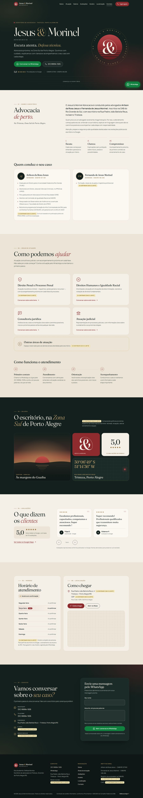

# Jesus & Morinel Advocacia — site institucional

Site one-page do escritório **Jesus & Morinel Advocacia** (Tristeza, Zona Sul de Porto Alegre/RS).
Construído em HTML, CSS e JavaScript puros, sem framework e sem etapa de build. É responsivo
(mobile-first), acessível e rápido.




---

## Estrutura

```
jesus-morinel-advocacia/
├── public/                  ← tudo o que vai para o ar
│   ├── index.html           ← página única (10 seções, SEO, Open Graph, JSON-LD)
│   ├── assets/
│   │   ├── css/styles.css   ← estilos (tokens de cor/tipografia no topo)
│   │   ├── js/main.js       ← menu, animações, carrossel, "aberto agora", formulário → WhatsApp
│   │   └── img/             ← favicon, ícones PNG e imagem de compartilhamento (og-image.png)
│   ├── robots.txt
│   ├── sitemap.xml
│   └── site.webmanifest
├── scripts/                 ← gerador da imagem de compartilhamento e dos ícones (opcional)
├── docs/                    ← prévias usadas neste README
├── vercel.json              ← configuração de deploy na Vercel
└── netlify.toml             ← configuração de deploy na Netlify
```

## Visualizar localmente

Qualquer servidor estático serve. Dentro da pasta `jesus-morinel-advocacia`:

```bash
# opção 1: Python (já vem no macOS/Linux)
cd public && python3 -m http.server 8080
# abra http://localhost:8080

# opção 2: Node
npx serve public
```

Abrir o `index.html` direto no navegador (duplo clique) também funciona. As fontes do
Google e o mapa dependem de internet.

## Deploy

### Vercel
1. Suba o repositório no GitHub.
2. Na Vercel: **Add New → Project → Import** o repositório.
3. Em **Root Directory**, escolha `jesus-morinel-advocacia`. O `vercel.json` já define
   `outputDirectory: public`, sem build.
4. **Deploy**.

Pela linha de comando: `cd jesus-morinel-advocacia && npx vercel` (prévia) e `npx vercel --prod`.

### Netlify
- **Arrastar e soltar:** acesse <https://app.netlify.com/drop> e arraste a pasta `public`.
- **Via Git:** *Add new site → Import from Git*, com **Base directory** `jesus-morinel-advocacia`.
  O `netlify.toml` já define `publish = "public"` e não há comando de build.

### Depois do deploy: configurar o domínio
O domínio ainda não existe, então as URLs absolutas usam o marcador `https://SEU-DOMINIO.com.br`
em `index.html` (Open Graph e JSON-LD), `robots.txt` e `sitemap.xml`. Troque todas de uma vez:

```bash
cd jesus-morinel-advocacia/public
# Linux
grep -rl "SEU-DOMINIO.com.br" . | xargs sed -i 's#https://SEU-DOMINIO.com.br#https://www.dominio-final.com.br#g'
# macOS
grep -rl "SEU-DOMINIO.com.br" . | xargs sed -i '' 's#https://SEU-DOMINIO.com.br#https://www.dominio-final.com.br#g'
```

Depois, descomente a linha `<link rel="canonical" …>` no `<head>` do `index.html`.
Para conferir, use o [Rich Results Test](https://search.google.com/test/rich-results) (dados
estruturados) e o [Sharing Debugger do Facebook](https://developers.facebook.com/tools/debug/)
(prévia do link).

---

## Pendências: itens marcados `[A CONFIRMAR COM O CLIENTE]`

Nenhum dado foi inventado. O que não estava disponível em fonte pública aparece no site com um
selo amarelo tracejado `[A CONFIRMAR COM O CLIENTE]` (classe CSS `tbc`, fácil de localizar com
busca). Confirme cada item abaixo com o cliente e depois remova o selo correspondente.

| # | Item | Onde aparece | Observação |
|---|------|--------------|------------|
| 1 | **Horário completo da semana** | Seção Horário e JSON-LD | O Google mostra apenas "Fecha 18:00". Veja [como editar](#horário-e-selo-aberto-agora). |
| 2 | **Número do imóvel** | Localização, JSON-LD | O perfil do Google não traz o número. |
| 3 | **CEP** | Localização, JSON-LD | ⚠️ O CEP do Google (**96203-270**) é de *Rua Padre Nilo Gollo, Rio Grande/RS*, ou seja, está **errado**. Na Rua Padre João Batista Reus (Porto Alegre) o CEP é **91920-000** (até nº 2830/2831) ou **91920-001** (de nº 2832/2833 em diante). Vale corrigir também no Perfil da Empresa no Google. |
| 4 | **Áreas de atuação** | Áreas de atuação | Direito Penal e Direitos Humanos/Igualdade Racial foram **inferidas** da formação do Dr. Arilson. Há um card reservado para as demais áreas. |
| 5 | **Currículo do Dr. Arilson** | Sobre → equipe | Tirado de publicação pública do PPGD/UFRGS. Confirme se está atualizado (por exemplo, se o mestrado já foi concluído). |
| 6 | **Bio da Dra. Fernanda** | Sobre → equipe | Só o nome e a OAB são públicos. |
| 7 | **Fotos** | Galeria e equipe | Por enquanto são composições gráficas e monogramas. Veja [como trocar](#fotos). |
| 8 | **E-mail e redes sociais** | Contato e rodapé | Nenhum perfil oficial foi encontrado. |
| 9 | **CNPJ e registro da sociedade na OAB/RS** | Rodapé | Nos índices de busca aparece "Jesus, Morinel e Silveira Advocacia", CNPJ 57.245.968/0001-03. **Não verificado.** Confirme antes de publicar. |
| 10 | **WhatsApp** | Todo o site | Presumido no mesmo número do Google, (51) 99994-1535, que é um celular. |
| 11 | **Domínio** | `<head>`, JSON-LD, robots, sitemap | Veja a seção [Deploy](#depois-do-deploy-configurar-o-domínio). |

---

## Como editar

### Horário e selo "Aberto agora"
No `index.html`, cada linha da tabela de horários tem um atributo `data-hours`:

```html
<tr data-day="1" data-hours="09:00-18:00">…            <!-- segunda: aberto -->
<tr data-day="3" data-hours="09:00-12:00,13:30-18:00">…<!-- intervalo de almoço -->
<tr data-day="6" data-hours="">…                        <!-- sábado: fechado -->
<tr data-day="0" data-hours="?">…                       <!-- a confirmar -->
```

O texto da tabela, o destaque de "Hoje" e o selo **"Aberto agora · fecha às 18h"** ou
**"Fechado agora · abre amanhã às 9h"** são gerados automaticamente no fuso de Brasília.
Depois de preencher, inclua o horário também no JSON-LD (dentro do objeto principal):

```json
"openingHoursSpecification": [
  {
    "@type": "OpeningHoursSpecification",
    "dayOfWeek": ["Monday", "Tuesday", "Wednesday", "Thursday", "Friday"],
    "opens": "09:00",
    "closes": "18:00"
  }
]
```

### Endereço completo no JSON-LD
```json
"streetAddress": "Rua Padre João Batista Reus, 1234 - Tristeza",
"postalCode": "91920-000",
```

### Avaliações
Os depoimentos ficam em `<ul class="carousel-track">`. Para incluir outra avaliação real do
Google, duplique um bloco `<li class="review">…</li>`. Copie o texto **exatamente** como foi
publicado e abrevie o sobrenome (ex.: "João S."). O carrossel se ajusta sozinho.

### Fotos
Na galeria, cada `<figure class="tile">` tem um comentário `FOTO` indicando onde trocar a
ilustração por uma imagem real:

```html

```

Use WebP ou JPEG de até ~1600px de largura, comprimidos. Nos cards da equipe, troque o
monograma (`AJ`, `FM`) por uma foto quadrada, conforme o comentário no código.

### Imagem de compartilhamento e ícones
Se o nome, a assinatura ou as cores mudarem, gere de novo o `og-image.png` e os ícones:

```bash
cd jesus-morinel-advocacia
npm i -D playwright && npx playwright install chromium
node scripts/gerar-imagens.mjs
```

---

## Direção de design: "Tinta, papel e rubi"

Visual editorial e humanista, sóbrio como a advocacia pede e próximo como as avaliações descrevem
o escritório ("atenciosos", "transmitem segurança").

| Papel | Cor | Uso |
|-------|-----|-----|
| Tinta | `#13201D` | Texto, hero, galeria, contato |
| Papel | `#F5F0E7` / `#ECE4D6` | Fundos claros |
| **Rubi** | `#8E2B2F` | Acento principal. O rubi é a pedra tradicional do Direito no Brasil (o anel de formatura) e remete ao pôr do sol do Guaíba, na Zona Sul |
| Latão | `#B38B55` / `#C9A874` / `#7D5E33` | Fios, detalhes, títulos auxiliares |
| WhatsApp | `#11813F` | Botões de WhatsApp, num tom com contraste AA para texto branco |

- **Tipografia:** [Fraunces](https://fonts.google.com/specimen/Fraunces) nos títulos, uma
  serifada editorial com eixo óptico, e [Manrope](https://fonts.google.com/specimen/Manrope) no
  texto corrido.
- **Assinatura visual:** o **"&" da Fraunces** é o monograma (favicon, logo e selo). Ele aparece num
  **selo circular** em rubi com linhas horizontais, que evocam o sol se pondo sobre o Guaíba e o
  bairro às margens do lago.
- **Micro-interações:** revelação suave ao rolar, header que ganha fundo ao rolar, sublinhado
  animado no menu, cards que sobem no hover e texto do selo girando devagar. Tudo é desligado para
  quem ativa "reduzir movimento" no sistema.

## Qualidade verificada

- **Acessibilidade:** 0 violações no [axe-core](https://github.com/dequelabs/axe-core)
  (WCAG 2.2 AA + boas práticas), no desktop e no celular. Inclui link "pular para o conteúdo",
  navegação completa por teclado, foco visível, menu mobile com foco preso e fechamento por
  <kbd>Esc</kbd>, textos alternativos e contraste ≥ 4,5:1 em todo texto.
- **Responsivo:** testado em 390px, 820px e 1440px, sem rolagem horizontal.
- **Performance:** nenhuma imagem bitmap na página (ilustrações em SVG inline). CSS e JS
  pequenos, JS com `defer`, mapa com `loading="lazy"` e fontes com `display=swap` e `preconnect`.
- **SEO:** `title` e `meta description`, Open Graph e Twitter Card com imagem 1200×630,
  `robots.txt`, `sitemap.xml` e JSON-LD `LegalService` + `LocalBusiness` com nome, endereço,
  telefone, coordenadas e advogados com OAB.
  - A nota do Google **não** foi incluída como `aggregateRating` no JSON-LD. A política do Google
    não aceita avaliações "autopromocionais" de `LocalBusiness` marcadas no próprio site, e isso
    pode gerar penalização manual.
- **Sem erros no console.** O formulário de contato não envia nada a servidor: ele só monta a
  mensagem e abre o WhatsApp.

## Conformidade com a OAB (Provimento nº 205/2021)

O texto foi escrito em tom informativo e sóbrio: sem superlativos, promessa de resultado, preços ou
o termo "especialista" (que exige título certificado). As inscrições na OAB aparecem nos cards,
no hero e no rodapé.

> ⚠️ **Atenção:** a seção de **avaliações/depoimentos** foi incluída a pedido, com as avaliações
> públicas do Google reproduzidas literalmente e com a fonte indicada. Alguns Tribunais de Ética da
> OAB consideram a divulgação de depoimentos de clientes em sites de advocacia incompatível com a
> vedação ao autoengrandecimento e à captação de clientela. Valide com o escritório. Para
> remover, apague a `<section id="avaliacoes">` e o link "Avaliações" dos menus.

## Fontes dos dados

| Dado | Fonte |
|------|-------|
| Nome, categoria, rua e bairro, telefone, nota 5,0 (19 avaliações), avaliações, "Fecha 18:00", Plus Code | Perfil do Google Maps |
| Coordenadas **-30.1136875, -51.2433125** | Decodificação do Plus Code `VQP4+GM` (código completo `48XCVQP4+GM`) |
| OAB/RS 127.160 (Arilson da Rosa Jesus) e OAB/RS 128.206 (Fernanda de Jesus Morinel) | Índices públicos de processos (Escavador) |
| Currículo do Dr. Arilson | Notícia do PPGD/UFRGS ("Arilson da Rosa Jesus, selecionado pela ONU para formação em Brasília e Suíça") |
| Faixas de CEP da rua e origem do CEP 96203-270 | Bases de CEP (Correios) |

Por privacidade, dados pessoais sensíveis que constam da publicação da UFRGS (como origem étnica
e comunidade de pertencimento) **não** foram usados. O escritório pode decidir incluí-los.
